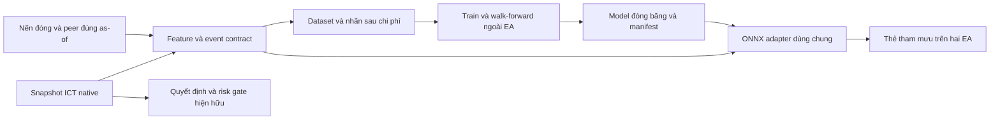

# Phương án học sâu cho Smart EA và DecisionSupport EA

Ngày tham mưu gốc: 20/11/2026; bổ sung bài toán SSL/BSL ngày 22/11/2026. Các đề xuất kiến trúc sau phần cập nhật vẫn là nghiên cứu; chưa có mô hình thắng cuộc trên dữ liệu broker.

## Cập nhật 22/11/2026 — SSL hay BSL untouched được chạm trước, bản 1.07

### Kết luận và phạm vi kết quả

**Đây là bài toán thứ tự chạm hai mức, cần huấn luyện bằng nhãn đường đi riêng. Xác suất giá đóng tăng/giảm của bản 1.04–1.06 không trả lời được câu hỏi này.** Bản 1.07 triển khai logistic và DNN riêng trong các module hiện có, với các mức native đóng băng tại thời điểm dự báo và xu hướng dài hạn D1. Không thay cấu trúc thư mục, engine giao dịch, bridge, scoring, SL/TP hoặc mặc định giao dịch.

Đã có 498 kiểm tra lõi đạt, gồm 40 ca mới so với bản 1.06. Những kiểm tra học mạng dùng dữ liệu tổng hợp có quan hệ được thiết kế trước; **không phải độ chính xác thị trường**. Chưa quan sát quá trình replay/fit và xác suất first-touch của một chart MT5 thực trong phiên này. Vì vậy không công bố một con số phần trăm SSL/BSL hiện tại, Brier broker hoặc lợi nhuận chưa được đo. Dashboard chỉ xuất phần trăm khi các điều kiện dữ liệu và kiểm định của chính chart đạt.

### Định nghĩa câu hỏi trước khi tính phần trăm

Tại thời điểm `t0` đóng nến LTF, lấy giá `x`, mức SSL phía dưới `a` và BSL phía trên `b`, với `a < x < b`. Chọn **mức gần nhất còn đủ điều kiện ở mỗi phía**, theo nhóm IRL/ERL đang bật; giữ nguyên pool ID, giá, khung nguồn và thời điểm có hiệu lực. Nếu cùng giá, ưu tiên nguồn khung lớn hơn. Không tự tạo một mức ATR để thay cho pool bị thiếu.

Mặc định `H=12` nến LTF liên tục sau `t0`, cho phép 1–24. Ba đầu ra là:

| Lớp | Điều kiện trên cặp mức đã cố định |
| --- | --- |
| BSL trước | Quan sát chạm/vượt `b` trước khi chạm `a`, trong H nến |
| SSL trước | Quan sát chạm/vượt `a` trước khi chạm `b`, trong H nến |
| Chưa chạm | Quan sát đủ H nến mà chưa chạm mức nào |

Ba lớp cộng thành 100% trên phân phối mà mô hình ước lượng; không ép hai hướng thành 100% bằng cách bỏ lớp chưa chạm. Ví dụ minh họa: giá 100, BSL 102, SSL 98; nếu chạm 102 trước rồi giảm xuống 97, nhãn là **BSL trước**, dù giá cuối kỳ giảm.

Nến có open đã vượt một mức được ghi nhận tại open trước high/low của chính nến. Nếu open ở giữa hai mức nhưng cả high và low chạm hai phía, OHLC không xác định được thứ tự: ghi `AMBIGUOUS`, không gán thuận xu hướng và không mặc định thành thắng/thua. Thiếu quan sát hoặc gap timestamp chưa phân loại bị loại, không biến thành timeout. Mẫu chỉ được đưa vào tập học khi đủ horizon; không lấy các mẫu thắng sớm nhưng còn thiếu thời gian quan sát làm lợi cho tập train.

**Giới hạn cần đọc cùng phần trăm:** hiện mô hình học trên những mẫu OHLC xác định được nhãn, sau khi loại mơ hồ/thiếu quan sát. Đây là xác suất có điều kiện trên cohort đó, chưa phải xác suất first-touch vô điều kiện trên toàn bộ tick thị trường. Loại mơ hồ có thể gây thiên lệch chọn mẫu; temperature scaling không sửa được vấn đề này. Cần tick hoặc dữ liệu nhỏ hơn đúng thời điểm để hoàn thiện nhãn. Dashboard và CSV ghi rõ phạm vi này.

### Untouched được kiểm tra thế nào

[Renderer](../Include/ICTRangeRenderer.mqh) làm đậm mức chưa bị sweep/consume/invalidated theo vòng đời native: nét liền 3 px, nhãn Semibold và ưu tiên bố trí nhãn. Nền sáng dùng đen, nền tối dùng trắng để giữ tương phản. Mức approaching nhưng chưa có sự kiện quét/phá cũng còn có thể là untouched theo vòng đời native.

[Bộ chọn xác suất](../Include/ICTStatisticalLearning.mqh) chặt hơn phần tô đậm: tra râu nến **từ lúc pool có hiệu lực đến t0**, chạm đúng giá cũng loại; không đợi xuyên qua tolerance sweep. Lịch sử phải bao phủ thời điểm có hiệu lực và không có gap chưa phân loại trong đoạn chứng minh chưa chạm. Mức đã bị chạm trong nến hiện tại cũng khiến dự báo cũ bị thu hồi. Vì vậy một mức có nhãn native untouched chưa chắc đủ dữ liệu để xuất xác suất.

### Mạng đang dùng và xu hướng dài hạn

[Runtime](../Include/ICTStatisticalDashboard.mqh) dùng một đối tượng `CICTRangeEngine` riêng để replay **hàm Step native** theo thời gian, với cùng cấu hình HTF/MTF/LTF. Không thay engine đang quyết định lệnh. Swing, period liquidity, tuổi pool và sự kiện chỉ dùng thông tin đã có tại từng prefix. D1/W1/MN1 dùng timestamp phiên broker; OHLC của kỳ đang chứa sự kiện không được dùng để lấy mức kỳ trước. Giới hạn seed history được giữ theo cấu hình native. Cuối replay, cặp pool được đối chiếu ID, giá, khung và as-of với snapshot thật được giữ ở đầu lần học; khác nhau thì không phát hành xác suất.

Hai bộ phân loại độc lập với mô hình giá đóng cũ:

- Logistic softmax: đối chứng ML, 99 trọng số/bias.
- DNN `32 → 12 → 6 → 3`: hai lớp ẩn tanh, 495 trọng số/bias, học bằng backpropagation thật. Không gọi đây là TCN/LSTM/Transformer.
- Trung bình cố định 50/50 sau hiệu chỉnh từng mạng; không dùng test để chọn trọng số kết hợp.

Vector 32 feature gồm OHLC chuẩn hóa của năm nến trước, khoảng cách đến hai mức theo ATR, vị trí tương đối trong cặp mức, bias cấu trúc native của range, khung và tuổi hai pool, spread/ATR, biến động 3/12 nến và bias dài hạn. Cửa sổ kiểm tra tính liên tục có 33 nến. Đây chưa phải vector đầy đủ SMT/Strong OB hay encoder chuỗi 33 nến.

Mặc định bias dài hạn là cấu trúc HH/HL hoặc LH/LL trên **120 nến D1 đã đóng**, điều chỉnh bằng `ML_Liquidity_Trend_Timeframe`. Nó vừa là feature để mô hình học tác động, vừa là điều kiện ưu tiên hiển thị khi `ML_Liquidity_Prefer_Long_Trend=true`. Nếu hướng có xác suất lớn nhất trái D1 hoặc D1 trung tính, hệ thống ghi chưa đồng thuận; giữ nguyên các phần trăm. **Không cộng một tỷ lệ thủ công cho thuận xu hướng.** Các mũi tên sweep thuận H1 của bản 1.06 vẫn giữ cách ưu tiên trước đó.

### Kiểm định và từ chối dự báo

Mặc định lấy 12.000 nến LTF, bước lấy mẫu bằng H để các horizon không chồng lấn. Chia 65% train, 15% hiệu chỉnh, phần còn lại test theo thời gian; bỏ thêm một mẫu ở mỗi ranh giới và kiểm tra timestamp kết thúc nhãn không vượt sang tập sau. Scaler, prior và trọng số chỉ fit trên train. Temperature chọn trên calibration, không trên test. Mặc định cần train ≥200, calibration/test mỗi phần ≥50; train có ≥15 mẫu/lớp, calibration và test có ≥5 mẫu/lớp để cho phép phát hành.

So sánh trên đúng các hàng test:

1. Prior ba lớp từ train.
2. Đối chứng khoảng cách: đặt `q=(x-a)/(b-a)` và `u=P_train(chưa chạm)`; dùng `(1-u)q`, `(1-u)(1-q)`, `u`. Đây là baseline kết hợp hình học và prior timeout, không phải công thức first-touch hữu hạn chính xác cho CFD.
3. Logistic, DNN và kết hợp; ghi Brier, log loss, ECE 10 bin cùng số mẫu từng lớp.

Chỉ xuất phần trăm khi đã hiệu chỉnh, đủ lớp, native pair khớp và Brier kết hợp thấp hơn **cả prior lẫn baseline khoảng cách**. Feature hiện tại lệch quá 5 độ lệch chuẩn so với scaler train bị chặn; không biến giá trị bị clip thành dự báo tự tin. Cặp mức thiếu một phía, lịch sử/gap không đủ, xu hướng chưa sẵn sàng, giá đã chạm trong nến hiện tại hoặc test chưa kết thúc trước t0 đều không được dùng lại phần trăm cũ.

Các ngưỡng trên là tiêu chí kỹ thuật ban đầu, không chứng minh độ tin cậy cho mọi symbol/regime. Một holdout và ECE tổng hợp chưa thay cho walk-forward nhiều fold, khoảng tin cậy theo block, độ tin cậy theo từng lớp và kiểm định trên broker khác. `validation_pass` có nghĩa qua các gate này, không có nghĩa đã nghiệm thu thị trường.

Khi runtime chạy, `ML_Liquidity_Save_Evidence=true` lưu CSV mẫu và kiểm định vào MQL5/Files, prefix `ICTLiquidity_<symbol-hash>_<ltf>_H<horizon>_<fit-bar>`. Mẫu chứa pool ID, hai mức/giá gốc, source TF, availability, trend as-of, nhãn/end time và 32 feature. File kiểm định ghi các ranh giới thời gian, số mẫu bị loại, nguồn OHLC, parity và metric. Chưa tuyên bố những file dữ liệu runtime này đã được tạo trên chart trong phiên phát triển.

### Kiểm tra lại nguồn nghiên cứu hiện có

Đã chạy lại [script kiểm kê](../Tests/.terminal/deep-learning-study/profile-data.ps1) trên [US500 M15](../ai/research-data/US500_M15_20241119_20261119.csv), đối chiếu [sidecar](../ai/research-data/US500_M15_20241119_20261119.csv.meta.json). [Kết quả kiểm kê](../Tests/.terminal/deep-learning-study/data-readiness.json) ghi:

| Kiểm tra | Kết quả ngày 22/11 |
| --- | --- |
| Nến / khoảng thời gian UTC | 47.066; 19/11/2024 00:00–18/11/2026 23:45 |
| Hash / số dòng so sidecar | Khớp |
| Trùng timestamp / sai thứ tự / sai OHLC-số | 0 / 0 / 0 |
| Khoảng >15 phút chưa phân loại | 520, chia thành 521 đoạn liên tục |
| Đoạn liên tục dài nhất | 92 nến |
| Cửa sổ 33 nến liên tục | 30.452 |
| Cửa sổ 33 nến + 12 nến sau liên tục | 24.253, trước lọc pool/trend/nhãn/split |
| Bid lịch sử / coverage phiên | Chưa xác minh; cả hai cờ sidecar là false |

24.253 cửa sổ có chồng lấn, không phải 24.253 cặp pool native hoặc cơ hội độc lập. CSV M15 không chứa snapshot native, tick và đầy đủ các khung broker D1/W1/MN1 cho hợp đồng này. Không lấy mô hình fit từ ứng viên Python khác rồi gán phần trăm cho hai đường native hiện tại; cũng không bật cờ provenance để ép fit. Nhánh 1.07 đọc lại dữ liệu đa khung của chính terminal/chart và vẫn ghi rõ nguồn chưa được chứng nhận độc lập.

### Cơ sở nghiên cứu và bước hoàn thiện

- [DeepHit, AAAI 2018](https://cdn.aaai.org/ojs/11842/11842-13-15370-1-2-20201228.pdf) mô hình hóa phân phối thời gian và loại biến cố đầu tiên khi có nhiều biến cố cạnh tranh. **Suy luận cho dự án:** hai phía thanh khoản cần một phân phối chung về biến cố đầu tiên; hai bộ dự báo “có chạm BSL”/“có chạm SSL” riêng có thể cùng cao vì cả hai xảy ra về sau. Nghiên cứu gốc về survival, không xác nhận lợi thế trading của EA. Bản 1.07 chưa triển khai loss survival/censoring của DeepHit.
- [Karl Sigman, Brownian motion](https://www.columbia.edu/~ks20/4106-18-Fall/Notes-BM.pdf) cho xác suất chạm một biên trước biên kia dưới giả định Brownian liên tục, không drift. Đây là lý do cần baseline khoảng cách; công thức vô hạn thời gian không xử lý drift, jumps, timeout H hay thị trường có phiên của EA.
- [Guo và cộng sự, ICML 2017](https://proceedings.mlr.press/v70/guo17a.html) là cơ sở temperature scaling. Hiệu chỉnh giúp đánh giá xác suất trên phân phối phù hợp, không giải quyết shift broker/regime, label mơ hồ hoặc bảo đảm đúng từng dự báo.
- [Bailey và cộng sự](https://www.davidhbailey.com/dhbpapers/backtest-prob.pdf) phân tích rủi ro overfit khi lựa chọn qua nhiều backtest. Vì vậy Brier thấp hơn trong một holdout chỉ là gate ban đầu; cần lưu toàn bộ trial và kiểm định nhiều đoạn thời gian.
- [TCN của Bai, Kolter, Koltun](https://arxiv.org/abs/1803.01271) hỗ trợ việc thử encoder causal trong giai đoạn sau; benchmark sequence tổng quát không xác định TCN thắng trên cohort SSL/BSL của broker.

Thứ tự hoàn thiện: **native replay/parity và nhãn first-touch → tick giải quyết mơ hồ, lịch phiên phân loại gap → walk-forward nhiều fold và ablation D1 → TCN32/competing risks so với logistic/DNN trên cùng cohort → shadow chart và ghi dự báo trước khi outcome xảy ra**. Nếu muốn biết xác suất chạm trong 1/4/12/24 nến đồng thời, dùng mô hình thời gian/cumulative incidence nhất quán; không ghép bốn classifier độc lập rồi chấp nhận đường xác suất giảm theo horizon.

### Bằng chứng triển khai và cài đặt

- [Báo cáo pure core](../Tests/Reports/ICT_UNIFIED_CORE_FIXTURES.txt): 498 kiểm tra, 0 thất bại, qua adapter cú pháp MQL→C#. Gồm các ca exact touch, mức đã dùng, missing coverage, pool ID parity, thứ tự hai barrier, ambiguity, timeout, future trend, kiểm định và ngoại suy; mạng học thật trên nhãn first-touch tổng hợp. Không thay thế runtime MT5 hoặc đánh giá broker.
- MetaEditor biên dịch sạch 6 chương trình: hai EA chính, `SmartRiskDashboard`, `ICTStatisticalLearningTests`, `ICTSweepFocusTests`, `ICTUnifiedTests`. Log trong `Tests/.terminal`, hậu tố `liquidity_first_touch_20261122.compile.log`. Nguồn đã sửa và binary build được đối chiếu SHA256 với bản trong runtime biên dịch.
- Đã sao lưu và thay hai EX5 EA 1.07 cùng bản indicator có cùng nguồn dự án tại vị trí cài hiện có. [Manifest](../Tests/.terminal/installed-ea-backups/sweep-focus-20261122-210400/manifest.json) ghi đầy đủ hash trước/sau; sau copy khớp bản build. Cấu hình chart không được sửa tự động, không bật chức năng giao dịch mới.
- Cần gỡ/gắn lại EA/indicator để nạp binary; sau đó đợi tải lịch sử, replay và học. Các cờ chờ là kết quả hợp lệ khi chưa đủ bằng chứng, không phải dự báo 0%. Chưa quan sát trực tiếp UI hoặc kết quả fit broker sau nạp trong phiên này.

## Phần tham mưu gốc ngày 20/11/2026

## 1. Phương án ưu tiên

**Ưu tiên TCN causal với cửa sổ 32 nến, ghép bối cảnh MTF, SMT và vòng đời OB; huấn luyện ngoài EA, đóng băng mô hình rồi suy luận ONNX dùng chung cho hai EA.** Cửa sổ 64 nến là đối chứng tiếp theo. Mục tiêu chính là xác suất TP trước SL trong thời hạn và R ròng kỳ vọng của một setup được định nghĩa trước.

Lý do chọn hướng này là mức phù hợp với mã và dữ liệu hiện có, chưa phải bằng chứng TCN có lợi nhuận cao nhất. DNN 1.04 vẫn là đối chứng dự báo hướng giá. PatchTST là ứng viên giai đoạn sau; LSTM/GRU là đối chứng về kiến trúc. Mô hình nền tảng có thể làm nguồn đặc trưng hoặc đối chứng ngoài EA khi xác định được dữ liệu, tài nguyên và điều kiện sử dụng.

Ba việc có giá trị cao nhất trước khi tăng kích thước mạng:

1. Đồng nhất hợp đồng dữ liệu, phiên giao dịch và thời điểm thông tin được biết.
2. Gắn nhãn theo entry, SL, TP, timeout và chi phí thực của setup; tách mục tiêu này khỏi dự báo hướng giá.
3. So sánh mô hình trên cùng tập cơ hội ngoài mẫu, giữ một đoạn cuối chưa mở để quyết định cuối cùng.

## 2. Khoảng trống thực tế trong hệ thống hiện tại

| Thành phần | Đã có và kiểm tra được trong mã | Khoảng trống cần bổ sung |
| --- | --- | --- |
| [ML/DL local](../Include/ICTStatisticalLearning.mqh) | Logistic ba lớp; DNN `32–12–6–3`; feature OHLC sáu nến, biến động, spread và bốn nhóm mẫu | Chưa có encoder chuỗi TCN/LSTM/Transformer; chưa nhận đầy đủ MTF, peer SMT và Strong OB native |
| Mục tiêu local | Tăng/giảm/ngang sau H nến giao dịch ngoài biên ATR + spread | Không phải TP trước SL, payoff sau commission/slippage hoặc khả năng thực thi entry |
| Kiểm định local | Train 65%, hiệu chỉnh 15%, kiểm định phần còn lại; có purge; scaler chỉ fit train | Một cửa sổ cuốn chiếu, chưa có nhiều fold, holdout cuối niêm phong hoặc so sánh độ bất định của chênh lệch Brier |
| [Dashboard local](../Include/ICTStatisticalDashboard.mqh) | Hiển thị trong cả hai EA, mặc định bật; Brier, số mẫu, tần suất mẫu giá | `Brier tốt hơn` chỉ là so sánh điểm tại một cửa sổ, chưa chứng minh lợi thế kinh tế; trọng số chưa có nhật ký phiên bản bền vững qua restart |
| [Nghiên cứu Python](../ai/market/research/ml.py), [RR](../ai/market/research/rr.py) | Walk-forward; outcome theo barrier; target grid; Ridge/MLP; thống kê calibration | Chưa có TCN/PatchTST, feature MTF/SMT/Strong OB native và calibration model cho nhánh snapshot |
| [Sequence Python](../ai/market/research/sequences.py) | Cửa sổ đóng, ATR tại xác nhận, không lấy entry/outcome làm feature | Chỉ một khung, vector phẳng; loại mọi gián đoạn timestamp. Local MQL lại đếm H nến giao dịch qua gián đoạn: hai hợp đồng đang khác nhau |
| [Portable model](../ai/market/research/portable_model.py) và [bridge](../Include/ICTMLPrediction.mqh) | Trọng số JSON, model pin, source/time gate, expiry, `ABSTAIN` | Không phải runtime cho mạng TCN bất kỳ; cần định dạng/adapter riêng nếu dùng ONNX và xác suất gắn với tín hiệu native |
| MTF/SMT/OB native | [Unified snapshot](../Include/ICTUnifiedAnalysis.mqh), [Strong OB](../Include/ICTStrongOrderBlock.mqh), [SMT](../Include/ICTDynamicSMT.mqh) và [kết quả tín hiệu](../Include/ICTSignalResult.mqh) đã tồn tại | Cần xuất feature đúng as-of từ các thành phần này; không tái tạo detector Python rồi mặc nhiên coi hai engine tương đương |
| Hai EA | [Smart](../Experts/ICTSmartDecisionEngineEA.mq5) tái dùng [DecisionSupport](../Experts/ICTDecisionSupportEA.mq5); phần thống kê dùng chung | Đường quyết định native của Smart là unified, DecisionSupport cũ còn đường legacy/range. Dùng chung dashboard không đồng nghĩa mọi tín hiệu đã đồng nhất |

Với đúng 6000 nến hợp lệ, H=4 và vòng lặp hiện tại, local tạo **1491 mẫu: 969 train, 223 hiệu chỉnh, 297 kiểm định**, bỏ hai mẫu ở ranh giới. DNN có 495 trọng số/bias; logistic có 99. Đây là phép đếm từ mã, không phải số mẫu độc lập hoặc bằng chứng đủ dữ liệu cho mọi trạng thái thị trường.

Các phần lịch sử trong [gap matrix](MTF_SMT_OB_GAP_MATRIX.md) cần đọc cùng [bàn giao MTF 09/11](MASTER_MTF_DELIVERY_20261109.md). Không tiếp tục coi mapper, Dynamic SMT hoặc Strong OB là chưa tồn tại chỉ vì audit 08/11 từng ghi thiếu.

## 3. Dữ liệu hiện có quyết định cửa sổ học sâu

Đã đối chiếu lại [CSV US500 M15](../ai/research-data/US500_M15_20241119_20261119.csv) với [sidecar](../ai/research-data/US500_M15_20241119_20261119.csv.meta.json) và [audit có sẵn](../ai/research-runs/US500_M15_20241119_20261119_audit.json). Đơn vị quan sát là một nến M15 của một symbol; không phải một giao dịch hoặc một setup độc lập.

| Kiểm tra trực tiếp | Kết quả | Ý nghĩa |
| --- | --- | --- |
| Số dòng | 47.066; khớp metadata | Có dữ liệu để kiểm tra pipeline; chưa phải 47.066 sự kiện giao dịch |
| Khoảng timestamp UTC | 19/11/2024 00:00 đến 18/11/2026 23:45 | Tập xuất cố định, không phải feed realtime ngày 20/11 |
| Timestamp trùng / không tăng / không parse được | 0 / 0 / 0 | Không phát hiện lỗi khóa và thứ tự trong lần kiểm tra này |
| Số không hợp lệ / hình học OHLC hoặc volume, spread âm | 0 / 0 | Điều kiện cú pháp và miền số đạt; không xác minh nguồn giá |
| SHA-256 CSV so với sidecar | Khớp | Tệp đúng bản mà metadata mô tả; hash không chứng nhận độ phủ hoặc broker |
| Khoảng cách giữa hai nến > 900 giây | 520 | Chưa phân loại giờ đóng thị trường, ngày nghỉ hay thiếu dữ liệu |
| Chuỗi timestamp liên tục dài nhất | 92 nến | Cửa sổ 128/256 không hoạt động với điều kiện liên tục hiện tại |
| Bid lịch sử / độ phủ phiên | Đều chưa xác minh | Chưa đủ điều kiện fit bundle được đánh dấu nguồn đã xác minh |
| Commission / contract history | Chưa biết / chưa xác minh | Chưa đủ cơ sở kết luận R ròng thực của broker |

Broker/server trong sidecar là `MetaQuotes Ltd.` / `connected-terminal`; chưa đủ để khẳng định đây là lịch sử của đúng tài khoản Exness đang xem. Cần đối chiếu nguồn xuất trước khi chuyển mô hình sang chart của broker khác.

Đếm lại khả năng tạo cửa sổ theo quy tắc **không có gián đoạn timestamp**:

| Cửa sổ quá khứ W | Cửa sổ liên tục có thể tạo | Cửa sổ còn đủ 16 nến liên tục phía sau |
| --- | ---: | ---: |
| 32 | 30.970 | 22.705 |
| 64 | 14.472 | 6.330 |
| 128 | 0 | 0 |
| 256 | 0 | 0 |

Các cửa sổ trên chồng lấn; số đếm chưa áp dụng detector, ATR, as-of MTF, nhãn barrier, purge hoặc chia fold. **Không dùng chúng làm số cơ hội độc lập.** Với mỗi đoạn liên tục dài L, phép đếm là `max(0, L−W+1)` và `max(0, L−W−16+1)`; kết quả cộng trên 521 đoạn. [Script đối chiếu](../Tests/.terminal/deep-learning-study/profile-data.ps1) và [kết quả](../Tests/.terminal/deep-learning-study/data-readiness.json) giữ phép tính có thể kiểm tra lại. CSV SHA-256: `a08536a6e5df722f5e6080f4ab10c27fb26aa42df0aa2140271f713cd2a5be97`.

**Hướng xử lý:** thí điểm session-only với W=32, đối chứng W=64 trên cùng tập cơ hội đủ điều kiện. Sau khi có lịch phiên broker, thử trading-clock có thêm thời gian thực đã trôi qua, ranh giới phiên và mask. Chỉ nối qua khoảng nghỉ đã được phân loại; khoảng thiếu dữ liệu bất thường vẫn loại. Không chèn OHLC giả, bỏ mọi gap gate hoặc bật `coverage_verified` để ép huấn luyện chạy.

## 4. So sánh các phương án

Thứ tự dưới đây là ưu tiên kỹ thuật suy ra từ dự án và nguồn nghiên cứu, không phải xếp hạng lợi nhuận đã đo.

| Phương án | Giá trị đối với dự án | Đổi lại / điều kiện | Khuyến nghị |
| --- | --- | --- | --- |
| Logistic, tần suất theo nhóm và MLP cùng nhãn sự kiện | Mức tham chiếu dễ kiểm tra; tận dụng pipeline hiện có | Cần cùng feature/cohort/chi phí với mô hình sâu; MLP local dự báo hướng không so trực tiếp với classifier TP/SL | Bắt buộc làm đối chứng |
| **TCN causal + context MTF/SMT/OB** | Học diễn biến mẫu qua thời gian; receptive field kiểm soát được; có thể bắt đầu bằng mạng nhỏ | Cần feature as-of và kiểm chứng export/inference; benchmark tổng quát chưa chứng minh lợi thế CFD | **Ưu tiên triển khai nghiên cứu đầu tiên** |
| LSTM/GRU nhỏ | Đối chứng xem bộ nhớ hồi quy có bổ sung tín hiệu so với convolution | Cần kiểm soát trạng thái/reset và parity inference; không giả định tốt hơn TCN | Thử cùng ngân sách sau baseline |
| PatchTST nhỏ + context fusion | Học patch dài hơn, có khả năng pretraining khi dữ liệu phù hợp | W=128 hiện không có mẫu theo hợp đồng gap hiện tại; thiết kế channel-independent cần thêm bước ghép context | Giai đoạn hai sau khi xử lý phiên |
| Chronos-2 / TimesFM | Đối chứng pretrained hoặc nguồn đặc trưng dự báo | Cần kiểm tra checkpoint, tài nguyên, training cutoff và điều kiện sử dụng; quantile giá không tự thành P(TP trước SL) | Nhánh nghiên cứu riêng ngoài EA |
| Deep reinforcement learning | Học chính sách hành động khi có simulator đáng tin cậy | Chưa có mô phỏng fill/chi phí/danh mục đủ kiểm chứng; dễ tối ưu lỗi simulator | Chưa ưu tiên cho trạng thái hiện tại |

[Nghiên cứu TCN](https://arxiv.org/abs/1803.01271) cho thấy convolution có thể là điểm khởi đầu tốt cho sequence modeling trong các benchmark của tác giả. Đây là cơ sở thử kiến trúc, không phải kết quả trên EURUSD hay US500. [Mã gốc](https://github.com/locuslab/TCN/blob/master/TCN/tcn.py) dùng convolution giãn, residual và cắt phần padding để giữ tính causal.

[PatchTST](https://arxiv.org/abs/2211.14730) dùng patch và chia sẻ trọng số giữa các kênh độc lập. **Suy luận thiết kế:** không mặc nhiên coi kiến trúc gốc đã học đầy đủ quan hệ SMT giữa hai symbol; cần context fusion và ablation riêng. [DLinear](https://arxiv.org/abs/2205.13504) cho thấy baseline tuyến tính có thể cạnh tranh trong benchmark dài hạn của nghiên cứu đó; kết quả này không xác định người thắng cho bài toán barrier của EA.

Tại thời điểm tra cứu, [Chronos-2](https://arxiv.org/abs/2510.15821) hỗ trợ dự báo đa biến và covariate. [TimesFM hiện công bố 3.0](https://github.com/google-research/timesfm), khác 2.5 về chức năng và điều kiện phát hành: tài liệu dự án ghi weights đến 2.5 vẫn Apache-2.0, còn [weights 3.0 tải về](https://huggingface.co/google/timesfm-3.0-pytorch/blob/main/LICENSE) giới hạn non-commercial/non-production. Vì vậy không chọn mặc định weights mới nhất để đưa vào EA vận hành. Đây là đối chiếu điều kiện được công bố, không phải xác nhận một mục đích sử dụng cụ thể đã được cấp phép.

Không đưa giá tương lai của peer hoặc covariate chưa biết vào đầu vào chỉ vì API mô hình nền tảng có hỗ trợ future covariates. Dự báo phân vị giá cuối kỳ cũng không xác định thứ tự chạm SL/TP trong đường đi.

## 5. Thiết kế TCN đề xuất

Giai đoạn đầu dùng **một encoder TCN cho LTF và vector context có timestamp cho MTF/HTF**. Cách này tận dụng bối cảnh đa khung mà chưa phải học ba encoder chuỗi khi dữ liệu còn ít hoặc gián đoạn. Chỉ bổ sung encoder chuỗi cho từng tầng nếu ablation chứng minh phần đó có ích.

- LTF: W=32, sáu kênh nhân quả như return, range/ATR, body/ATR, râu trên/ATR, râu dưới/ATR, spread/ATR. Thứ tự kênh và normalization phải khóa trong schema.
- TCN: ba residual block, mỗi block hai convolution, kernel=3, dilation `1,2,4`; khởi đầu 16 channel/block. Receptive field suy ra là `1 + 2×(3−1)×(1+2+4) = 29` nến. W=32 cấp đủ ngữ cảnh cho cấu hình này.
- Đối chứng W=64 dùng thêm dilation 8, receptive field 61. Không kết luận từ việc chỉ tăng W nhưng giữ nguyên receptive field ngắn.
- Context: trạng thái HTF/MTF đã đóng; khoảng cách đến OB/FVG/ERL theo ATR; điểm xác nhận và tuổi/touch/lifecycle OB **đã biết tại as-of**; trạng thái SMT từng peer, dấu tương quan, tuổi xác nhận, tình trạng thiếu dữ liệu; hướng và nhóm setup.
- Ghép embedding TCN với context bằng đầu MLP nhỏ. Output đầu tiên là logits cho `TP_FIRST / SL_FIRST / TIMEOUT`; đầu thứ hai dự báo R ròng của hành động có target và horizon được định nghĩa.

Không dùng label, entry tương lai, cực trị sau tín hiệu, ngày invalidation về sau, P/L cuối cùng hoặc ID hash làm feature có thể học thuộc. Session/gap mask chỉ có giá trị nếu quy tắc tạo mask giống lúc train và lúc chạy.

Tại as-of LTF, chỉ dùng MTF/HTF có close time không mới hơn as-of; thời gian đóng tháng theo lịch. Peer SMT cần timestamp được ghép đúng, không ghép tùy ý theo cùng vị trí mảng. Peer thiếu phải có mask hoặc từ chối tùy hợp đồng đã huấn luyện; không thay bằng giá 0 hoặc tự đổi peer không ghi nhận.

## 6. Học mục tiêu phù hợp với việc tham mưu

Hai bài toán cần tách riêng:

| Bài toán | Đầu vào / đơn vị mẫu | Điều mô hình có thể tham mưu |
| --- | --- | --- |
| Dự báo trạng thái giá | Một nến xác nhận và ngữ cảnh quá khứ | Tăng/giảm/ngang sau H nến; tiếp tục giữ làm chỉ báo bối cảnh |
| Đánh giá setup | Một sự kiện với hướng, entry policy, SL, TP và horizon cố định | P(TP trước SL), P(timeout), R ròng kỳ vọng; dùng để đánh giá hoặc xếp hạng ứng viên nghiên cứu |

Ví dụ minh họa: entry 100, SL 99, TP 102; giá cuối kỳ 102,5 nhưng đã xuống 98,8 trước đó. Dự báo hướng tăng có thể đúng trong khi sự kiện TP trước SL là sai. Vì vậy Brier/accuracy của hai bài toán không được so trực tiếp với nhau.

Mỗi setup phải có event ID ổn định, timestamp xác nhận, chính sách entry sau xác nhận và danh tính nguồn detector. Chấm tín hiệu native và phát hiện ứng viên thống kê độc lập là hai cohort riêng; thay detector không được xem là chỉ thay mô hình.

Khởi đầu khóa một horizon và một target RR phù hợp policy hiện hữu để so kiến trúc. Grid `RR={2,3,4}` hoặc nhiều horizon là bước nghiên cứu sau, được tính thêm trial. Các target của cùng event phải nằm cùng fold; outcome của mọi hành động được so sánh phải đủ điều kiện tại cutoff.

[Outcome hiện có](../ai/market/research/outcomes.py) đã xử lý bid/ask proxy, slippage, timeout và trường hợp hai barrier cùng nến. Cần tiếp tục giữ `AMBIGUOUS` là bất định, `CENSORED` là thiếu quan sát; không ép thành thắng/thua. Đầu probability loại nhãn mơ hồ; nghiên cứu payoff có thể dùng biên bất lợi đã định nghĩa và công bố độ nhạy.

Entry ở close đã biết không tự là entry có thể khớp. Nhãn phải dùng quote có thể quan sát sau xác nhận hoặc proxy next-open được nêu rõ. Với tick Bid/Ask, đo thứ tự chạm và gap fill trực tiếp; với OHLC, giữ bất định intrabar. Commission, slippage, spread, contract/tick size và phí giữ qua phiên cần phù hợp từng giai đoạn broker.

R ròng nên học từ payoff mô phỏng đã trừ chi phí. Không suy ra nó chỉ từ `P(TP) × RR − P(SL)`: timeout có payoff riêng, gap fill có thể khác −1R và chi phí thay đổi. Không trừ phí lần hai nếu target regression đã là net R.

## 7. Thí nghiệm và điều kiện chọn mô hình

Đây là thiết kế thí điểm đề xuất, không phải ngưỡng thống kê đã được chứng minh cho mọi thị trường.

1. Chọn một symbol/timeframe có dữ liệu được xác minh; dùng cùng tập event cho baseline và mô hình sâu. US500 M15 hiện có dùng kiểm tra kỹ thuật và kiểm kê dữ liệu; chưa đủ gate để phát hành mô hình kinh tế. Nếu ưu tiên Forex, thu EURUSD M15 cùng H1/D1 và peer khả dụng theo broker trước.
2. Chia thời gian thành nhiều vòng walk-forward. Bên trong mỗi vòng: train → tập chọn cấu hình/early stopping → tập fit calibration → test. Purge mọi nhãn chưa kết thúc tại ranh giới. Embargo, nếu áp dụng, phải theo thời hạn nhãn thực và quy tắc split đã khóa; không dùng một số bar tùy tiện cho mọi trường hợp.
3. Scaler, chọn feature, class prior, pretraining tự giám sát và mọi tham số ensemble chỉ được fit từ phần quá khứ được cho phép. Không đưa OHLC của test vào masked pretraining rồi gọi kết quả là hoàn toàn ngoài mẫu. Với checkpoint pretrained, ghi rõ training cutoff biết được và giới hạn khi không xác minh được.
4. Mở đầu bằng baseline tần suất/logistic, MLP event-label và TCN32. Sau đó ablation `+MTF`, `+SMT`, `+OB`, kết hợp đủ, rồi W64 trên **cùng tập đủ W64**. Không so TCN32 trên 22.705 cửa sổ với TCN64 trên 6.330 cửa sổ rồi quy toàn bộ chênh lệch cho kiến trúc.
5. Báo Brier, log-loss, reliability theo bin có số mẫu, và chênh lệch so baseline trên cùng hàng. Bootstrap theo block thời gian ghép cặp; chọn block trong thiết kế để xử lý phụ thuộc. Báo kết quả theo fold, symbol, nhóm setup và regime đủ mẫu, không chỉ gộp toàn kỳ.
6. Calibration fit trên phần riêng; baseline và classifier phải cùng nhãn và population. [Nghiên cứu temperature scaling](https://proceedings.mlr.press/v70/guo17a.html) hỗ trợ thử phương pháp này, nhưng không xác nhận xác suất thị trường đã đúng. [Tài liệu calibration](https://scikit-learn.org/stable/modules/calibration.html) cũng lưu ý Brier thấp hơn không tự chứng minh calibration tốt hơn.
7. Chỉ đánh giá hiệu quả kinh tế sau khi có fill/cost contract: R ròng trên cohort, turnover, phân bố tail và tỷ lệ abstain. Drawdown, Sharpe và tương quan danh mục cần paper ledger theo vốn và lệnh đồng thời; không cộng R của các event chồng nhau thành lợi nhuận tài khoản.
8. Ghi mọi cấu hình và seed đã thử, kể cả thất bại. Giữ đoạn cuối niêm phong đến khi khóa lựa chọn và threshold. [Deflated Sharpe Ratio](https://davidhbailey.com/dhbpapers/deflated-sharpe.pdf) giải thích ảnh hưởng số trial và lựa chọn kết quả đẹp; chỉ tính DSR khi có chuỗi returns và thông tin trial phù hợp, không áp vào accuracy của classifier.

Mô hình chỉ được gọi là tốt hơn đối chứng khi cải thiện lặp lại qua các fold, có hỗ trợ mẫu và độ bất định phù hợp. Để gọi là phương án tham mưu có giá trị kinh tế, cần thêm kiểm tra payoff sau chi phí và rủi ro danh mục. Kết quả trung bình tốt nhưng phụ thuộc một giai đoạn hoặc một nhóm mẫu không đủ để chọn làm mặc định chung.

## 8. Đưa mô hình đã chọn vào cả hai EA

Kiến trúc đề xuất:

[MQL5 hỗ trợ ONNX](https://www.mql5.com/en/docs/onnx/onnx_mql5) qua tạo session, đặt input/output shape và `OnnxRun`. Tài liệu cũng nêu giới hạn operator/type; vì vậy một file export được chưa đủ để xác nhận chạy đúng trên terminal đang cài.

Các phần cần có:

- Model manifest khóa symbol/broker, task/label version, TF set, feature order, shape/dtype, scaler, session policy, train cutoff, model hash, calibration và cohort kiểm định. Một hash không thay cho kết quả kiểm định.
- Adapter ONNX dùng chung từ [EA chính](../Experts/ICTDecisionSupportEA.mq5), không tạo hai bản logic inference lệch nhau cho Smart và DecisionSupport.
- Bộ mẫu tham chiếu xác nhận Python → ONNX → MQL cho cùng feature tensor và output; tolerance float32 được định trước rồi kiểm tra trên terminal thực. Kiểm thử đổi symbol/TF, restart, thiếu peer, dữ liệu đến chậm và model không khớp schema.
- Suy luận khi có nến/event mới và cache theo `(model ID, symbol, TF set, asof, event ID)`. Đo latency p95 trên máy thực và ngân sách CPU khi mở nhiều chart; không giả định tốc độ từ máy huấn luyện.
- Thiếu model, stale, thiếu feature bắt buộc hoặc drift vượt ngưỡng đã thiết kế thì báo không đủ bằng chứng. Ghi dự báo **trước outcome**, model version và lý do abstain vào log để shadow có thể đối chiếu.

Nhánh ONNX là phần đề xuất, chưa được tích hợp trong 1.04. Bridge tệp hiện có vẫn là đường khả dụng cho thử nghiệm bên ngoài. Nếu mở rộng protocol, tạo version mới và giữ parser phiên bản cũ nghiêm ngặt; không nhét payload mới vào schema cũ rồi bỏ kiểm tra.

Thẻ tham mưu nên phân biệt: bối cảnh hướng giá local; xác suất setup đã hiệu chỉnh; net R kỳ vọng; số mẫu kiểm định; model/data age; lý do từ chối. Xác suất cao không đổi `NO_TRADE` thành tín hiệu đã xác nhận và không sửa nhật ký native hoặc SL/TP.

## 9. Thứ tự triển khai theo giá trị và phụ thuộc

| Ưu tiên | Việc thực hiện | Kết quả cần có để chuyển bước |
| --- | --- | --- |
| P0 | Xác minh nguồn giá, broker/server, lịch phiên, contract/chi phí; đo funnel nguyên nhân chưa có tín hiệu | Dataset có provenance và gap được phân loại; phân biệt khan hiếm setup với lỗi vận hành |
| P1 | Event/feature exporter từ snapshot native; đối chiếu as-of Python–MQL; logger dự báo không sửa lịch sử | Cùng event ID, timestamp và feature được tạo lại theo prefix; không rò rỉ tương lai |
| P2 | Logistic/MLP cùng nhãn barrier và TCN32; calibration riêng; thử W64 và ablation khi đủ mẫu | Bảng so sánh ngoài mẫu trên cùng cohort, kết quả theo fold và tác động chi phí |
| P3 | Export model đã chọn, parity ONNX–MQL, cache và shadow trong hai EA | Dự báo trước outcome khớp inference offline; latency và độ ổn định được đo thực |
| P4 | PatchTST hoặc pretraining/foundation khi cần thêm thông tin | Chứng minh cải thiện bổ sung so với P2, có dữ liệu và điều kiện sử dụng phù hợp |

**Phần nên làm ngay tiếp theo là P0 và P1, sau đó TCN32.** Đây là đường ngắn nhất để biến học sâu thành tham mưu có thể kiểm chứng trong hai EA. Mở rộng mạng trước khi thống nhất nhãn, gap và feature native sẽ khiến kết quả khó so sánh dù số lớp tăng lên.

## 10. Giới hạn của lần tham mưu này

Lần này kiểm tra dữ liệu đầu vào và thiết kế phương án; không huấn luyện TCN/Transformer, mở holdout, kết nối tài khoản hay thay EX5 đang cài. Kết quả 451 kiểm tra offline và 27 lượt compile của 1.04 được ghi ở [tài liệu tích hợp](ML_PREDICTION_EA.md), không phải kết quả so mô hình sâu trên broker. Không có căn cứ để đưa ra win rate, lợi nhuận hoặc tên mô hình tối ưu nhất đã được xác nhận.
