# Kiến trúc đích và kế hoạch chuyển đổi — hai thành phần

Quy định có hiệu lực tại [MASTER_PROMPT.md](MASTER_PROMPT.md); [FEATURE_MATRIX.md](FEATURE_MATRIX.md) ghi trạng thái thực tế. Mô hình sau là **đích**, chưa được nghiệm thu. Tài liệu lịch sử bên dưới phản ánh thiết kế cũ và không phải đặc tả đích.

## Ranh giới

1. **ICT Smart Decision Engine** sở hữu phân tích ICT, tổng hợp một kết quả quyết định và bằng chứng, biểu đồ, dashboard, lịch sử tín hiệu. Các detector, indicator và adapter chỉ là module kỹ thuật. Không tự tính hoặc sao chép logic rủi ro, không gửi lệnh mở.
2. **EA Smart Risk Manager Pro** sở hữu tính toán rủi ro và bảo vệ tài khoản. Nhận kế hoạch, trả kết quả và lý do từ chối; giám sát mọi vị thế và chỉ đóng khẩn cấp khi đã được xác nhận theo chính sách. Đóng vị thế/cancel pending trong bảo vệ không phải mở giao dịch mới.

Hợp đồng đích phải có phiên bản, định danh tài khoản/symbol/khung và nguồn, thời gian nến xác nhận và thời gian phát hành, giá entry/SL/TP, hướng, điều kiện vô hiệu, trạng thái dữ liệu; phản hồi phải gắn cùng định danh kế hoạch, ghi thời gian, trạng thái hợp lệ, RR, khối lượng, tiền rủi ro, chi phí, lý do. Không cho kết quả cũ hoặc không khớp tài khoản/symbol nâng trạng thái. Đây là đặc tả cần triển khai, chưa phải hợp đồng đang có.

## Kế hoạch triển khai và cổng nghiệm thu

1. **Chặn mở lệnh:** loại đường mở lệnh trong mã nguồn; kiểm tra cả EX5 được cài trong MT5, rà soát các đường gọi trade, kiểm thử không phát sinh lệnh mở. Bản EX5 cũ không tự được thay thế.
2. **Lập baseline:** thu thập danh mục chức năng Phase 2/3/4 và hai nguồn cũ, dữ liệu đầu vào và đầu ra, test hiện có; xác định khác biệt và giữ bằng chứng trước khi thay đường phân tích. Hai dự án cũ chưa được đối chiếu đầy đủ.
3. **Thống nhất hợp đồng:** triển khai dữ liệu phiên bản và kiểm tra độ mới; tách risk calculation khỏi luồng ICT, giữ chính sách bảo vệ, test lỗi/mất service và thay đổi tài khoản.
4. **Hợp nhất engine:** hợp nhất evidence và trạng thái từ DecisionSupport, advisory, ICT core/SMT/range thành một quyết định; chuyển các giao diện cũ thành adapter dùng cùng kết quả, loại bản sao chỉ sau khi so sánh hành vi và replay.
5. **Hoàn thiện UI và lịch sử:** các panel và overlay dùng snapshot chung; lưu tín hiệu theo thời điểm xác nhận và kết quả kiểm thử, không suy diễn kết quả tương lai. Xác minh symbol SMT, timezone và dữ liệu broker.
6. **Nghiệm thu:** build MT5, replay nến đóng, kiểm tra repaint/look-ahead và hiệu chỉnh dữ liệu, so khớp EA/indicator, test RR/lot/3%/xác nhận/hedging/netting/mất kết nối, chứng minh dashboard bằng dữ liệu thực và không mở lệnh. Compile không thay thế runtime.

Các phần tích hợp, xác nhận ngưỡng 3% và kiểm thử đầy đủ vẫn chưa hoàn thành; không công bố đạt nghiệm thu cho đến khi có bằng chứng tương ứng.

### Điểm vào Smart Decision và đề xuất SMT

`ICTSmartDecisionEngineEA` dùng chung DecisionSupport để phân tích cấu trúc, thanh khoản, OB/FVG, confluence, range và hiển thị. Khi `Auto_Suggest_SMT_Symbols=true`, ô comparison để trống được chọn từ **các symbol đã có trong Market Watch** theo trị tuyệt đối tương quan lợi suất trên nến đã đóng tại khung SMT: cửa sổ tối đa 100, ít nhất 60 cặp và |r| >= 0,60. Tương quan âm và dương đều được chọn; cùng điểm dùng thứ tự tên. Symbol tự nhập được giữ ưu tiên, hai lựa chọn khác nhau và khác symbol chính. Có thể không tìm thấy đủ hai symbol; EA không giả lập hay tự chọn symbol không đủ dữ liệu. Danh sách được cập nhật khi có nến SMT đóng mới và thử lại nếu còn thiếu; thay đổi được ghi Journal. Bộ phân tích quyết định và vẽ SMT cùng dùng cặp đã chọn. Lựa chọn này chỉ là đề xuất thống kê, không xác nhận quan hệ nhân quả hay đảm bảo tín hiệu SMT. Kiểm thử runtime và so sánh dashboard/indicator vẫn chưa hoàn tất.

EA Smart Decision cũng công bố chính snapshot quyết định của nó qua `ICTDecisionBridge.mqh` để phần ICT DECISION của indicator trên cùng chart sử dụng. `RiskCalculationService` dùng cùng hàm xuất khi chạy theo đường cũ; đây là tương thích chuyển tiếp, không phải đã loại toàn bộ đường quyết định song song. MT5 chỉ cho một EA mỗi chart: khi gắn Smart Decision, calculator chart-scoped cũ không đồng thời phục vụ indicator trên chính chart đó. Việc chuyển calculation sang EA quản trị qua hợp đồng liên chart vẫn chưa triển khai; không coi cầu snapshot này là hợp đồng rủi ro hoàn chỉnh.

## Thiết kế trước chuyển đổi (lịch sử)

## Runtime placement

| Chart | Component | Responsibility |
| --- | --- | --- |
| Dashboard chart | `SmartRiskDashboard` indicator plus `RiskCalculationService` EA | Planner and risk inputs; existing advice; new ICT decision summary via account/chart-scoped terminal global variables. No trade submission. |
| Protection chart | `RiskProtectionEA` | Independent account-wide monitoring and emergency cancel/close. Publishes heartbeat, health, lock, reference and automatic-protection-enabled flag. |
| Optional analysis chart | `ICTDecisionSupportEA` | Detailed new decision evidence, chart levels, optional SMT and portfolio warnings. No trade submission. |

MT5 permits one EA per chart. The optional analysis EA does not replace the calculator or protection EA.

## Decision flow

```mermaid
flowchart LR
  A[Closed OHLC bars and current quote] --> B[Validate bars and broker symbol data]
  B --> C[Monthly/Weekly/Daily context and H4/H1 pivots]
  C --> D[DOL candidate ranking]
  D --> E[Confirmed sweep]
  E --> F[Confirmed MSS after sweep]
  F --> G[Confirmed FVG and displacement after MSS]
  G --> H[Premium/discount and retest]
  H --> I[Independent risk and protection gates]
  I --> J[Decision state, evidence, score and reason]
```

`MarketStructure`, `LiquidityDetector`, `FVGDetector`, `SMTDivergenceDetector`, `SymbolCorrelationEngine`, `RiskCalculator` and `ProtectionPersistence` are reused. `ICTDecisionEngine` owns the new event sequence, DOL selection and vetoes. `ICTSessionManager` labels the current New York session. `RiskCalculationService` publishes the new result separately from the existing Phase 3 advisory, so either model can be inspected without silently replacing the other.

## Boundaries and failure behavior

- Closed bars are copied from shift 1 onward. Pivot confirmation needs right-side closed bars. Sweep, MSS and FVG ordering compares their **confirmation close times**. The bar open timestamp remains in the output as evidence.
- `ENTRY READY` requires current broker risk calculation, RR at least 2, valid stop/volume/margin, spread below the configured limit, healthy enabled protection, and optional daily loss gate. Score cannot bypass these conditions.
- The protection EA is the only component that sends emergency trade requests. The new analysis path has no order API calls. Its `TRADE ACTIVE` state uses an observed account position matching direction, entry zone and stop; it does not claim strategy ownership of that ticket.
- A missing or stale service timestamp clears the dashboard's decision display. The dashboard also checks protection live before rendering a cached `ENTRY READY`.
- The provisional score is context only. Optional SMT and New York session points may be unavailable, and current-session time is not a historical broker timezone reconstruction.
- History revisions, chart reloads, quote gaps, broker-specific symbol values and partial fills require runtime evidence. Compile success does not establish operational or trading-performance acceptance.

## Extension points

Future implementations should add versioned event records, session calendar/holiday data, more PD-array definitions with original-source evidence, portfolio risk limits, chart event history and historical replay. Preserve the separation between analysis, risk calculation and emergency execution when doing so.
