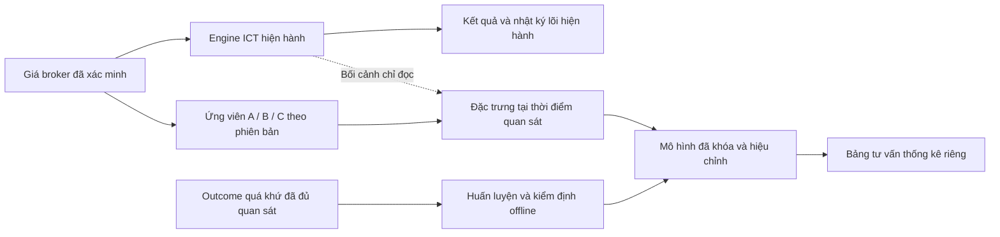

# Đề xuất bổ sung tín hiệu thống kê cho ICT Smart Decision Engine

Ngày nghiên cứu: 18/11/2026. Phạm vi: kiểm toán mã, kiểm kê dữ liệu trên máy và thiết kế nghiên cứu. **Chưa huấn luyện mô hình, chưa có kết quả backtest ngoài mẫu, chưa xác định mẫu hình có lợi thế.**

## 1. Đề xuất chính

Giữ nguyên engine ICT và bổ sung một lớp **ứng viên thống kê độc lập**. Lớp này tìm các sự kiện giá được định nghĩa trước, ước lượng xác suất đạt mục tiêu trước dừng lỗ trong một thời hạn xác định, rồi báo cả kỳ vọng sau chi phí và độ bất định.

Có hai sản phẩm khác nhau:

| Sản phẩm | Tác dụng | Ảnh hưởng số cơ hội |
| --- | --- | --- |
| Chấm xác suất cho tín hiệu ICT đã có | Xếp hạng, giải thích và kiểm tra chất lượng tín hiệu hiện hành | Không tạo thêm cơ hội; lọc tiếp có thể làm ít hơn |
| Phát hiện ứng viên thống kê theo bộ quy tắc riêng | Tìm cơ hội chưa vượt toàn bộ chuỗi ICT hiện hành | Có thể tạo thêm ứng viên; phải đo số cơ hội độc lập và chất lượng ngoài mẫu |

Ưu tiên nghiên cứu sản phẩm thứ hai; dùng sản phẩm thứ nhất làm đối chứng. Điểm hội tụ hiện hành vẫn có ý nghĩa cũ. Một giá trị 80/100 không được chuyển thành xác suất thắng 80%.

Các ứng viên mới chỉ mang nhãn nghiên cứu/tư vấn. Không ghi vào `BUY_CONFIRMED`, `SELL_CONFIRMED`, `score`, `priority`, `risk_pass`, nhật ký tín hiệu hay cầu nối đặt SL/TP hiện hữu. Nếu sau này cần giao dịch các ứng viên mới, đó phải là chính sách riêng được kiểm chứng và lựa chọn rõ ràng.

## 2. Những gì kiểm tra được trong dự án

### 2.1. Vì sao cần phân biệt thiếu mẫu hình và lỗi vận hành

- [Ánh xạ khung](../Include/ICTTimeframeMapper.mqh) tự động dùng M15/H1/D1 khi chart là M15. [Kết quả cuối](../Include/ICTSignalResult.mqh) yêu cầu ba tầng đã đóng, HTF/MTF cùng hướng, phản ứng LTF đúng trình tự, mục tiêu hợp lệ và kiểm tra risk/RR.
- [Bộ ghép unified](../Include/ICTUnifiedDecisionAdapter.mqh) có thể từ chối do HTF trung tính, MTF thiếu hoặc xung đột. Thêm điểm số không vượt qua các điều kiện này.
- [Engine quyết định](../Include/ICTDecisionEngine.mqh) còn kiểm tra giá hiện tại, spread, bộ bảo vệ, hạn mức vốn và RR ròng. [Điểm confluence](../Include/ICTConfluenceScore.mqh) là trọng số cấu hình, chưa được học từ kết quả giao dịch.
- SMT không bắt buộc theo mặc định. Không có căn cứ quy việc ít tín hiệu nói chung cho SMT.
- Ảnh chart trước đó có lỗi lưu **SMT payload journal**: [unified analysis](../Include/ICTUnifiedAnalysis.mqh) làm snapshot không hợp lệ khi lưu thất bại, khiến đường quyết định bị chặn. Ngoài ra, [EA](../Experts/ICTDecisionSupportEA.mq5) có veto riêng khi **nhật ký tín hiệu đã xác nhận** không lưu được. Hai nhật ký cần được chẩn đoán riêng. Đây là lý do vận hành cần đo riêng với sự khan hiếm setup; nghiên cứu xác suất không sửa được lỗi lưu dữ liệu.
- Chưa có thống kê funnel đầy đủ để kết luận điều kiện nào gây loại nhiều cơ hội nhất. Lý do cuối cùng từ một chuỗi `return` sớm không đại diện cho mọi điều kiện không đạt.

### 2.2. Kiểm kê dữ liệu thật

Kiểm tra lại lúc **2026-11-18 13:01:13 UTC**, chỉ đọc:

| Nguồn | Quan sát | Có thể kết luận |
| --- | --- | --- |
| Nhật ký `ICT_signals_*.csv` của terminal đang dùng | 58 tệp, 539 dòng đúng định dạng 38 trường; 0 dòng sai định dạng; 0 khóa trùng theo symbol/LTF/MTF/HTF/asof | Đây là các quan sát còn được giữ lại |
| Trạng thái trong các dòng trên | 539 `NO_TRADE`, 0 `WATCH`, 0 xác nhận BUY/SELL | Không có kết quả giao dịch để ước lượng tỷ lệ thắng |
| US500 M15 | Không có dòng nhật ký tín hiệu tương ứng trong lần kiểm tra này | Không suy ra US500 M15 chưa từng có cơ hội |
| Cache Exness-MT5Trial6 | US500, USTEC, EURUSD, GBPUSD, XAUUSD đều có 9 tệp năm mang tên 2018–2026 | Có nguồn cache tiềm năng để xuất và kiểm tra |
| Tệp dữ liệu trong workspace | Chưa tìm được OHLC CSV/Parquet hoặc database tệp dùng được cho nghiên cứu | Chưa có tập nến đã xuất và xác minh trong workspace |

Lượt đọc trước đó thấy 533 dòng; terminal tiếp tục ghi nên số dòng thay đổi. Không gộp hai lượt thành hai mẫu độc lập.

Tệp cache có mặt không chứng minh đầy đủ lịch sử 2018–2026, số nến, độ phủ tick, loại giá hoặc múi giờ. Cần lấy dữ liệu qua API MT5 và kiểm tra từng khoảng thực tế. Không tự giải mã cache thành dữ liệu được coi là chuẩn.

Nhật ký [CICTSignalHistory](../Include/ICTSignalHistory.mqh) có cơ chế rút gọn, mặc định cửa sổ 60 nến. Nó không phải sổ quan sát đầy đủ mọi nến và không chứa đường giá tương lai, fill, exit hay P/L thực hiện. Những dòng `CONFIRM` trong nhật ký detector OB/SMT cũng không đồng nghĩa giao dịch `BUY/SELL_CONFIRMED`.

Vì vậy **539/539 NO_TRADE không phải tỷ lệ từ chối trên toàn thị trường**, không phải win rate 0%, và không đủ để xác định tần suất tín hiệu lịch sử. PostgreSQL chưa được truy vấn trong nghiên cứu này; số 0 nến trong tài liệu Phase 3 cũ không được xem là số hiện tại.

### 2.3. Thành phần có thể dùng tiếp

- [Script xuất nến](../Tests/ExportMarketCandles.mq5), [importer](../ai/market/data.py), [models có provenance](../ai/market/models.py), [orchestrator](../ai/market/services.py) và [kiểm thử replay theo prefix](../ai/market/test_analysis.py).
- [Replay range hiện có](../Tests/ICTRangeReplayEA.mq5) có paper ledger và chi phí ước tính, nhưng không chạy toàn bộ đường quyết định unified như EA thực tế.
- [Tài liệu tích hợp](MT5_AI_INTEGRATION.md) xác nhận Python và MQL có quy tắc riêng. Kết quả Python không tự động chứng minh hiệu quả của EA.

## 3. Cơ sở nghiên cứu và giới hạn chuyển giao

Lo, Mamaysky và Wang tìm thấy một số mẫu kỹ thuật cung cấp thông tin bổ sung trong dữ liệu cổ phiếu Mỹ theo ngày. Điều đó hỗ trợ cách biến hình mẫu thành thuật toán có thể kiểm định; không xác nhận hiệu quả ICT, FVG hoặc US500 CFD M15 tại broker này. [Nghiên cứu gốc](https://business.columbia.edu/sites/default/files-efs/pubfiles/19268/Lo-Mamaysky_wang_foundations.pdf).

Khi thử nhiều quy tắc rồi chọn quy tắc đẹp nhất, kết quả dễ phản ánh nhiễu. Phải lưu toàn bộ cấu hình đã thử và đánh giá ảnh hưởng của việc lựa chọn. [Sullivan–Timmermann–White](https://onlinelibrary.wiley.com/doi/10.1111/0022-1082.00163), [Bailey và cộng sự](https://www.davidhbailey.com/dhbpapers/backtest-prob.pdf).

Với mô hình xác suất, khả năng xếp hạng đúng chưa đủ: các nhóm được dự báo cùng xác suất cần có tần suất xảy ra phù hợp. Dùng reliability diagram cùng Brier score/log loss; Brier score riêng lẻ không tách được calibration và khả năng phân biệt. [Tài liệu calibration](https://scikit-learn.org/stable/modules/calibration.html).

**Suy luận thiết kế cho dự án:** bắt đầu với ba giả thuyết đơn giản, thống kê theo sự kiện và mô hình ít tham số; chỉ mở rộng khi kết quả ngoài mẫu cho thấy thông tin bổ sung.

## 4. Ba nhóm ứng viên ưu tiên

Đây là các định nghĩa hệ thống đề xuất để nghiên cứu, không phải mô hình đã được chứng minh có lợi nhuận. Mỗi nhóm đối xứng BUY/SELL; mọi mức tham chiếu phải đã được biết trước sự kiện.

### A. Quét thanh khoản và đóng trở lại — `SWEEP_RECLAIM`

1. Có pool đã xác nhận: đỉnh/đáy phiên trước hoặc pivot đã đủ nến xác nhận. Khởi đầu dùng PDH/PDL và pivot, chưa thêm vùng phiên thiếu timezone/DST.
2. Một nến đóng có râu vượt pool quá tolerance rồi đóng trở lại bên trong. Tolerance và cách tính ATR giữ cố định trong mỗi phiên bản nghiên cứu.
3. Phát sinh ứng viên tại thời điểm đóng nến reclaim; giá vào nghiên cứu là quote khả dụng đầu tiên sau đó. Không giả định vào đúng giá đóng đã biết.
4. Stop nằm ngoài cực trị sự kiện cộng buffer đã định nghĩa; loại nếu khoảng risk không hợp lệ.
5. HTF/MTF alignment, độ sâu sweep/ATR, số lần quét cùng pool và SMT đã biết tại entry là đặc trưng đo hiệu quả. MSS xuất hiện sau entry chỉ được lưu làm diễn biến theo dõi, không đưa vào bộ dự báo lúc entry. Một biến thể chờ MSS phải có version riêng và entry sau khi MSS được xác nhận. Các đặc trưng này không tự biến ứng viên thành tín hiệu ICT lõi.

**Câu hỏi:** reclaim có lợi thế riêng trong bối cảnh nào, trước khi đòi hỏi toàn bộ chuỗi xác nhận? Có bao nhiêu cơ hội tăng thêm, và tổn thất nào xuất hiện khi vào sớm hơn?

### B. Hồi kiểm FVG lần đầu sau xung lực — `FVG_FIRST_RETEST`

1. FVG ba nến chỉ có sau khi nến thứ ba đóng; xung lực và độ lớn gap được chuẩn hóa theo ATR tính từ dữ liệu đã biết.
2. Chỉ xét lần chạm đầu tiên ở một nến sau thời điểm FVG được xác nhận. Nến đóng phản ứng theo hướng gap và phía thích hợp của midpoint.
3. Phát sinh ứng viên sau nến phản ứng. Stop ở biên xa của vùng cộng buffer; FVG bị xuyên hết hoặc vô hiệu trước ứng viên không được dùng.
4. Tuổi vùng, độ lấp, vị trí trong dealing range, BOS trước đó và xu hướng H1/D1 là đặc trưng.

**Câu hỏi:** lần hồi kiểm đầu tiên có tốt hơn mọi lần chạm không? Yêu cầu sweep trước đó có thực sự bổ sung kỳ vọng ngoài mẫu không?

### C. Phá mức và hồi kiểm giữ mức — `BREAK_RETEST`

1. Một nến đóng vượt pivot/mức cấu trúc đã xác nhận, quá tolerance cố định.
2. Một nến về sau hồi kiểm mức đó rồi đóng giữ ở phía vừa phá, theo hướng phá. Có giới hạn thời gian chờ để tránh gắn một retest rất muộn vào sự kiện cũ.
3. Phát sinh ứng viên sau nến retest đóng; stop ngoài cực trị retest cộng buffer. Không ghi fill tại mức retest đã đi qua trong quá khứ.
4. Độ mạnh phá mức, khoảng chờ retest, biến động, session và khoảng cách đến mục tiêu là đặc trưng.

**Câu hỏi:** continuation này bổ sung cơ hội khi không có một sweep đảo chiều hoàn chỉnh hay không?

### Phạm vi vòng nghiên cứu đầu

- Ưu tiên **US500 M15**, thêm USTEC làm nguồn peer nếu đồng bộ dữ liệu; bối cảnh H1/D1 từ nến broker đã đóng. M5 hoặc XAUUSD là nghiên cứu chuyển giao về sau, không gộp ngay để làm lớn mẫu.
- Một định nghĩa cơ sở cho mỗi nhóm. Các thay đổi tolerance, stop, horizon hoặc entry là thử nghiệm mới và phải được ghi vào sổ nghiên cứu.
- Rejection Block/Breaker/BPR đã có thành phần detector nhưng để vòng sau; không mở hàng chục mẫu cùng lúc. SMT trước mắt là đặc trưng bổ sung, không là điều kiện chung mới.
- Một sự kiện có một khóa ổn định theo symbol, phiên bản, nguồn pool/zone, hướng và thời điểm xác nhận. Không đếm cùng vùng trên 10 nến thành 10 cơ hội độc lập.

## 5. “Xác suất” cần trả lời đúng câu hỏi

### 5.1. Nhãn kết quả

Đề xuất thí nghiệm so sánh ban đầu: mục tiêu cố định **+2R**, stop **−1R**, thời hạn **16 nến M15 sau entry**. Đây là cấu hình nghiên cứu khởi tạo, chưa tối ưu; 16 nến là số nến giao dịch, không mặc định tương đương 4 giờ qua đóng cửa thị trường.

Mục tiêu +2R ở thí nghiệm này tính trước chi phí. Sau chi phí nó thường không đáp ứng yêu cầu RR ròng tối thiểu 2 của lõi. Vì vậy, phép so sánh này chưa tạo ra kế hoạch live đủ chuẩn; nghiên cứu kế hoạch có thể hành động phải đặt target đáp ứng RR ròng hiện hành và gán nhãn lại đúng chính sách đó.

Một mẫu có một trong các kết quả:

- `TP_FIRST`: chạm +2R trước stop và trong thời hạn.
- `SL_FIRST`: chạm stop trước mục tiêu.
- `TIMEOUT`: đến hạn chưa chạm hai biên; đóng theo quote khả dụng ở thời điểm hết hạn và ghi R thực hiện.
- `AMBIGUOUS`: thiếu độ phân giải để biết biên nào chạm trước.
- `UNFILLED`: chỉ áp dụng cho nghiên cứu limit có quy tắc fill/hết hạn riêng.
- `CENSORED`: dữ liệu kết thúc trước khi quan sát đủ outcome; không tự gán thành thua hoặc timeout.

Mục tiêu xác suất chính là `P(TP_FIRST trước SL và hạn | đặc trưng tại entry, chính sách entry/exit)`. Timeout vẫn thuộc mẫu số của các mẫu đã đủ quan sát. Có thể học ba lớp TP/SL/timeout và báo R timeout riêng. Không tính win rate chỉ trên TP+SL rồi im lặng bỏ timeout.

`P(+2R)` không phải xác suất chạm một pool TP cách entry 3.4R. Nếu dashboard dùng TP theo pool, phải ghi lại target thực tại thời điểm quyết định, học nhãn tương ứng và tính đến khoảng cách target. Không chuyển xác suất giữa hai chính sách thoát lệnh.

### 5.2. Tính chi phí và kỳ vọng

Với R là khoảng lỗ giá trước phí đã cố định tại entry:

`E[R_net] = 2 × p_TP − p_SL + p_timeout × E[R_timeout] − E[cost_R]`

Đây là dạng cho payoff +2R/−1R; khi gap, slippage hoặc exit khác biên, dùng payoff thực mô phỏng của từng outcome. Mỗi mẫu trừ phí đúng một lần. Nếu spread đã phản ánh qua giá Ask vào/Bid ra, không trừ lại cùng spread như một khoản phí thứ hai.

Chỉ trong trường hợp không timeout, không gap/slippage, payoff cố định và phí trung bình cR, điều kiện hòa vốn mới rút gọn thành `p_TP > (1+c)/3`. Không dùng ngưỡng xác suất tùy ý như 70% cho mọi mẫu, mọi RR.

Tính song song số mẫu, khoảng bất định, R ròng trung bình, drawdown, tail loss, thời gian giữ, fill rate và tần suất cơ hội. Limit order phải tách `P(fill)` với outcome sau fill; “giá chạm vùng” không bảo đảm khớp.

## 6. Tập dữ liệu và chống thông tin tương lai

### 6.1. Dữ liệu cần xuất từ cache broker

- Nến đóng M1/M15/H1/D1 cùng nguồn; lấy M5 nếu bắt đầu nghiên cứu M5. Ưu tiên lịch sử đủ dài qua nhiều chế độ biến động, mục tiêu ban đầu khoảng 24 tháng trở lên nếu broker cung cấp.
- Timestamp mở/đóng và thời điểm khả dụng, timezone/offset lịch sử, lịch giao dịch/nghỉ theo symbol và DST. Không coi giờ server mã hóa là UTC.
- Loại giá thật của chart; OHLC, tick volume, spread theo point, point/tick size và metadata hợp đồng. Với chứng khoán/CFD có điều chỉnh giá, ghi thay đổi hợp đồng và cách nguồn điều chỉnh.
- Bid/Ask ticks ở các cửa sổ entry/exit để phân giải fill, TP/SL và spread. [MqlRates](https://www.mql5.com/en/docs/constants/structures/mqlrates) có spread; [CopyTicksRange](https://www.mql5.com/en/docs/series/copyticksrange) cung cấp tick theo khoảng thời gian, nhưng khả năng trả đủ dữ liệu phải kiểm tra thực tế.
- Commission, swap nếu giữ qua đêm, slippage mô phỏng và các kịch bản stress; metadata hiện tại không được coi là lịch sử phí đã xác minh.
- Manifest gồm broker/server, symbol, phạm vi thực, thiếu khoảng nào, số nến, loại giá, hash dữ liệu, phiên bản mã và cấu hình nghiên cứu.

[Exporter hiện tại](../Tests/ExportMarketCandles.mq5) chỉ ghi timestamp/OHLC/tick volume và giới hạn 100.000 nến mỗi lần gọi. Cần xuất theo khoảng/chunk có manifest cho lịch sử dài. [Model MarketCandle](../ai/market/models.py) chưa có spread/ticks/đặc tả hợp đồng; không giả định importer giữ được những cột mới nếu chưa mở rộng schema hoặc kho thực thi riêng.

### 6.2. Kiểm tra bắt buộc trước tính hiệu quả

1. Khóa series đầy đủ, timestamp tăng, không trùng; OHLC hợp lệ, spread không âm và đơn vị thống nhất.
2. Tách gap do thị trường đóng và thiếu dữ liệu. Không forward-fill nến giả, không xóa gap rồi xem chuỗi là liên tục.
3. Pivot chỉ khả dụng sau nến xác nhận bên phải; FVG sau nến thứ ba đóng; HTF chỉ dùng bar đóng trước thời điểm ứng viên.
4. Vùng/pool được chọn từ snapshot lúc đó. Không dùng trạng thái “về sau còn fresh”, target tốt nhất nhìn từ cuối lịch sử hoặc peer được chọn nhờ tương quan tương lai.
5. Tạo đặc trưng từ prefix quá khứ; outcome lưu ở bảng riêng. Chạy kiểm tra prefix độc lập cho cả feature và candidate IDs.
6. Nếu cùng nến chạm stop/target: ưu tiên tick thật, tiếp đến nến nhỏ; nếu vẫn không rõ, giữ nhãn ambiguous và báo cả biên bảo thủ. Không chỉ xóa mẫu mơ hồ vì có thể làm lệch mẫu.
7. Một market entry khớp ở quote khả dụng tiếp theo, có gap và spread; không dùng giá low/high đã xảy ra trước lúc tín hiệu được biết.
8. Bản EA cài thực tế, bản nguồn và settings phải có hash/version. Không trộn nhật ký từ nhiều phiên bản thành một chiến lược duy nhất.

Engine Python hiện từ chối gap nến kể cả đóng cửa thị trường. Cần lịch phiên/segment và warmup phù hợp trước khi dùng nó cho nhiều tháng. Muốn đo hiệu quả chính xác của logic EA cũ phải replay đúng bộ detector/adapter MQL dùng chung hoặc chứng minh parity từng sự kiện; không thay bằng engine Python tương tự.

## 7. Ước lượng xác suất và kiểm định

### 7.1. Bắt đầu bằng thống kê đơn giản

Lập bảng theo mẫu hình và một số bối cảnh thô: HTF/MTF aligned, neutral hay conflict; session đã xác minh; biến động thấp/vừa/cao; tuổi vùng; khoảng cách mục tiêu/risk; SMT có/không/không đủ dữ liệu.

Không chia đồng thời mọi chiều thành hàng trăm ô nhỏ. Báo số sự kiện và số ngày/tuần độc lập của mỗi ô. Ước lượng có shrinkage về base rate của nhóm lớn hơn; prior và binning chỉ lấy từ quá khứ của tập train. Thiếu hỗ trợ thì trả `INSUFFICIENT_SAMPLE`, không nội suy thành xác suất chắc chắn.

Khoảng Wilson phù hợp để minh họa bất định tỷ lệ trên mẫu Bernoulli độc lập; thị trường có tương quan nên dùng thêm block bootstrap theo ngày/tuần và cluster theo sự kiện. Không gọi số nến là số mẫu độc lập. [Hướng dẫn NIST](https://www.itl.nist.gov/div898/handbook/prc/section2/prc241.htm).

Ví dụ toán học, **không phải kết quả giao dịch**: nếu 50/100 mẫu độc lập thành công, Wilson 95% khoảng 40.38–59.62%; nếu 200/400, khoảng 45.12–54.88%. Ngay cả 400 mẫu cũng không biến xác suất thành hằng số; tương quan và thay đổi chế độ còn làm việc ước lượng khó hơn.

### 7.2. Mô hình có điều kiện sau bảng thống kê

- Baseline: xác suất lịch sử của từng nhóm, chỉ ước lượng trên train.
- Mô hình đầu: logistic có regularization hoặc multinomial TP/SL/timeout; số đặc trưng hạn chế, missing có trạng thái riêng. Sau đó mới thử cây nông/boosting nếu có cải thiện ổn định.
- Đặc trưng gợi ý: hướng và trạng thái từng TF; độ sâu sweep/ATR; độ lớn gap/ATR; body/range của nến; tuổi/lần chạm vùng; khoảng cách pool/risk; volatility; spread/risk; session; trạng thái peer SMT. ATR, quantile và chuẩn hóa fit trên train.
- Không coi tick volume là khối lượng giao dịch toàn thị trường. Không đưa kết quả sau entry, lifecycle tương lai hoặc score tính lại trên lịch sử tương lai vào feature.
- Fit bộ hiệu chỉnh xác suất trên đoạn calibration đi sau train và trước test; không dùng CV ngẫu nhiên mặc định. Cân nhắc sigmoid khi mẫu ít; isotonic chỉ khi đủ dữ liệu và có bằng chứng cải thiện.
- Brier/log loss so với baseline, reliability diagram kèm số mẫu, cùng kỳ vọng giao dịch ròng. AUC hoặc accuracy riêng lẻ không đủ để chọn mô hình.
- LLM/Ollama có thể giải thích bằng chứng đã tính; không tự tạo p%, thay nhãn outcome hoặc chọn setup theo văn bản kể chuyện.

### 7.3. Chia thời gian và kiểm soát lựa chọn

1. Đăng ký trước định nghĩa ba nhóm, entry, stop, target, horizon, chi phí, các biến thể được thử và tiêu chí chọn.
2. Walk-forward theo lịch. Ví dụ khởi tạo nếu đủ dữ liệu: 9 tháng fit → 3 tháng calibration → 3 tháng test, tiến 3 tháng mỗi fold. Giữ ba tháng cuối làm kiểm tra cuối chưa dùng để sửa mô hình. Đây là thiết kế đề xuất, không phải chia đã chạy.
3. Loại khỏi train các mẫu có cửa sổ outcome chồng lên calibration/test; áp dụng cùng nguyên tắc giữa calibration và test. Chỉ mẫu có outcome đã biết trước mốc fit mới được học. Khoảng cách bảo vệ theo thời gian/label end, không chỉ đếm hàng ứng viên.
4. [TimeSeriesSplit](https://scikit-learn.org/stable/modules/generated/sklearn.model_selection.TimeSeriesSplit.html) minh họa thứ tự train/test và gap, nhưng event data không cách đều cần splitter theo timestamp; class này không tự purge các nhãn chồng lấn.
5. Calibrator, threshold và lựa chọn feature chỉ dựa train/calibration. Không xem test rồi chỉnh ngưỡng và gọi cùng test là ngoài mẫu lần nữa.
6. Ghi mọi trial, kể cả mô hình thất bại. Khi có đủ universe chiến lược, dùng phương pháp điều chỉnh chọn nhiều thử nghiệm như Reality Check/SPA hoặc PBO phù hợp; giữ forward test độc lập. Không xem một holdout duy nhất là bảo đảm hết overfit.
7. Kiểm tra từng giai đoạn/volatility regime và transfer sang symbol khác mà không tối ưu lại. Dùng stress spread/slippage, độ trễ entry và tham số lân cận để phát hiện lợi thế quá mong manh.

## 8. Đo đúng mục tiêu “thêm cơ hội có chất lượng”

Đối chiếu bốn nhóm trên cùng lịch sử đủ chất lượng:

| Nhóm | Vai trò |
| --- | --- |
| Logic ICT hiện tại, version/settings cố định | Baseline thực tế |
| Mọi ứng viên A/B/C, chưa lọc bằng xác suất | Đo thông tin gốc và tần suất của mẫu hình |
| Ứng viên A/B/C qua mô hình đã khóa | Đo giá trị bổ sung của xếp hạng xác suất |
| Hợp các ứng viên thống kê và tín hiệu lõi, đã khử trùng | Đo số cơ hội tăng thêm và rủi ro chung |

Thống kê hai tầng: **mọi sự kiện** để nghiên cứu mẫu hình; và **portfolio mô phỏng khả thi** với giới hạn vị thế, exposure tương quan, trùng tín hiệu và chi phí. Không cộng R của các giao dịch không thể cùng được thực hiện.

Funnel lưu: dữ liệu hợp lệ → sự kiện khác nhau → ứng viên hình học hợp lệ → có outcome đủ quan sát → đủ hỗ trợ mô hình → được khuyến nghị → đủ kiểm tra risk hiện tại. Với từng gate lưu `PASS/FAIL/UNKNOWN/NOT_EVALUATED`; phân biệt số nến ở trạng thái, số sự kiện, số ứng viên, số lệnh giả định và số fill.

Tiêu chí lựa chọn đề xuất:

- Kỳ vọng R ròng ngoài mẫu dương, báo khoảng block-bootstrap và độ nhạy chi phí; nếu khoảng còn quá rộng thì giữ ở nghiên cứu.
- Xác suất hữu ích hơn baseline trên dữ liệu mới, calibration không lệch có hệ thống; giới hạn sai lệch và tiêu chuẩn chọn phải khóa trước test.
- Số cơ hội **tăng thêm sau khử trùng**, số/tháng và số/1.000 nến hợp lệ được báo cùng chất lượng, không tối đa hóa số mũi tên.
- Báo drawdown/tail loss và mức tập trung lợi nhuận theo giai đoạn; không chọn chỉ nhờ một tháng tốt hoặc một vài giao dịch lớn.
- Kiểm tra cuối chưa chạm và shadow forward xác nhận; thời gian forward dựa vào số mẫu/độ bất định, không chỉ đủ vài tuần là tự động đạt.
- Phải chấp nhận kết quả “chưa tìm thấy lợi thế đủ bằng chứng”. Không ép hệ thống xuất tín hiệu vì đã dành công xây dựng.

## 9. Tích hợp đề xuất, giữ nguyên đường quyết định hiện hành



Các module dưới đây là **hạng mục đề xuất, chưa được tạo**:

| Hạng mục | Nhiệm vụ |
| --- | --- |
| Export snapshot/candidate MQL riêng | Ghi chứng cứ và gate tại thời điểm biết được, dùng chung detector; không chạm kết quả lõi |
| `market/research/candidates` | Định nghĩa A/B/C, ID ổn định, chronology và bản cấu hình |
| `market/research/outcomes` | Fill, TP/SL/timeout, chi phí và ambiguity theo chính sách đã khóa |
| `market/research/validation` | Walk-forward, purge theo label end, bootstrap, trial ledger và benchmark |
| `market/research/calibration` | Base rate, mô hình xác suất, calibration và hỗ trợ mẫu |
| Kho nghiên cứu riêng | Dataset manifest, candidate, feature snapshot, label, prediction, model run; version bất biến |
| Dashboard/renderer thống kê riêng | Nhãn, xác suất đã kiểm định, kỳ vọng, sample support, lý do và hạn hiệu lực |

Hợp đồng prediction tối thiểu:

`schema_version, research_version, dataset_hash, feature_version, model_id, train_end, calibration_end, symbol, broker, timeframe, as_of, candidate_id, family, direction, entry_policy, entry_reference, stop, target, horizon, p_tp, p_sl, p_timeout, expected_net_R, support_n_oos, support_cluster_count, uncertainty_method, aggregate_interval, cost_model_id, valid_until, support_status`.

`aggregate_interval` mô tả bất định tỷ lệ/kỳ vọng của cohort; không gắn CI Wilson của cohort vào một xác suất từng giao dịch như thể đó là cùng đại lượng. Thiếu mô hình hợp lệ, thiếu đặc trưng, sai version, dữ liệu ngoài miền hỗ trợ hoặc prediction quá hạn thì xác suất là null và trạng thái giải thích rõ, không thay bằng 0 hay 50%.

Trình bày ví dụ bằng trường, không số giả: “US500 M15 — FVG hồi kiểm lần đầu; xác suất TP trước SL: …; horizon: …; mẫu ngoài nghiên cứu: …; kỳ vọng sau phí: …; bối cảnh ICT lõi: NO_TRADE / lý do …”. Có thể cùng lúc core NO_TRADE và có ứng viên thống kê; không trình bày ứng viên đó như xác nhận của core.

Giai đoạn đầu chỉ chạy offline và shadow. Nếu tương lai bổ sung đề xuất có thể hành động, mọi kiểm tra dữ liệu/quote/spread, hình học, RR ròng hiện hành, vốn, margin, exposure, bảo vệ và giới hạn tổn thất vẫn phải được thực hiện độc lập tại thời điểm đó. Xác suất cao không cấp quyền vượt các kiểm tra này.

## 10. Thứ tự thực hiện khuyến nghị

1. **Khôi phục/ghi nhận chất lượng vận hành**: lỗi journal, version EX5/settings và dữ liệu từng TF; đo funnel chỉ đọc của lõi. Không đổi tiêu chí tín hiệu để che lỗi.
2. **Tạo corpus kiểm chứng**: xuất cache US500 và peer, xác minh lịch phiên/giờ/giá/spread, snapshot bất biến và hash. Chưa đủ dữ liệu thì dừng việc gán xác suất, tiếp tục đặc tả/thu thập.
3. **Replay và gán nhãn**: baseline lõi đúng phiên bản và ba nhóm A/B/C; ghi cả mẫu bị từ chối, timeout, ambiguous, không fill; kiểm tra chống nhìn trước và parity.
4. **Thống kê → mô hình nhỏ → kiểm định theo thời gian**: chọn bằng cải thiện sau chi phí và ngoài mẫu; khóa tập kiểm tra cuối.
5. **Shadow trên chart**: xuất bảng tư vấn riêng, đối chiếu xác suất dự báo với outcomes phát sinh thật, theo dõi drift và ngừng báo khi dữ liệu/mô hình không còn phù hợp.

Sản phẩm đầu tiên nên là **bảng hiệu quả ngoài mẫu của ba nhóm trên US500 M15**, kèm chi phí, độ bất định và số cơ hội tăng thêm; chưa nên bắt đầu bằng một model AI phức tạp hoặc đặt trước mục tiêu win rate.

## Phụ lục: cách kiểm tra lại bằng chứng

Nguồn terminal đã đọc: `%APPDATA%/MetaQuotes/Terminal/D0E8209F77C8CF37AD8BF550E51FF075/MQL5/Files`; cache ở `bases/Exness-MT5Trial6/history`. Đây là vị trí quan sát của máy này, không là đường dẫn cố định trong sản phẩm.

Đoạn PowerShell chỉ đọc để kiểm kê lại nhật ký; kết quả sẽ thay đổi khi MT5 tiếp tục ghi:

```powershell
$journalRoot = Join-Path $env:APPDATA 'MetaQuotes/Terminal/D0E8209F77C8CF37AD8BF550E51FF075/MQL5/Files'
$journalFiles = @(Get-ChildItem -LiteralPath $journalRoot -File -Filter 'ICT_signals_*.csv')
$bad = 0
$rows = @(foreach ($file in $journalFiles) {
    foreach ($line in [IO.File]::ReadAllLines($file.FullName, [Text.Encoding]::Unicode)) {
        if ([string]::IsNullOrWhiteSpace($line)) { continue }
        $f = $line.Split([char]9)
        if ($f.Count -ne 38 -or $f[0] -ne '1') { $bad++; continue }
        [pscustomobject]@{
            Symbol = $f[2]; LTF = [int]$f[3]; State = [int]$f[8]
            Confirmed = [int]$f[22]; Key = ($f[2..5] -join '|') + '|' + $f[9]
        }
    }
})
[pscustomobject]@{
    captured_utc = [DateTime]::UtcNow.ToString('o')
    files = $journalFiles.Count; rows = $rows.Count; malformed = $bad
    no_trade = @($rows | Where-Object State -eq 0).Count
    watch = @($rows | Where-Object { $_.State -in 1,2 }).Count
    confirmed = @($rows | Where-Object Confirmed -eq 1).Count
    duplicate_keys = @($rows | Group-Object Key | Where-Object Count -gt 1).Count
    US500_M15 = @($rows | Where-Object { $_.Symbol -eq 'US500' -and $_.LTF -eq 15 }).Count
} | ConvertTo-Json
```

Kiểm tra trên chỉ xác minh định dạng số trường và khóa đã nêu, không chứng minh tính đúng đắn của từng payload/giá hoặc đầy đủ quan sát. Không chạy backtest, không truy vấn PostgreSQL, không triển khai EX5 và không sửa logic giao dịch trong lần nghiên cứu này.
